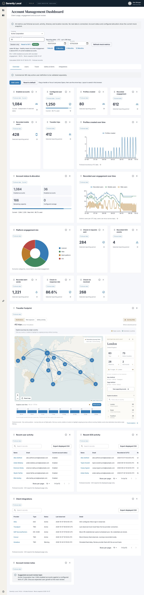

# AM Dashboard Prototype

Interactive client engagement and account-management concept built with React, TypeScript, Vite and Material UI. **Serenity Local / HULA** is fictional branding. All customers, users, events, integrations, alerts, locations and metrics are fabricated. This is solely a UX/product prototype: no backend, authentication, customer/provider APIs or real customer information.

[Live demo](https://richardhanney.github.io/am-dashboard-poc/)



## Local development

Use Node 22.13+ or Node 24+ (deployment uses Node 24).

```sh
npm ci
npm run dev
```

Open the Vite URL, normally `http://127.0.0.1:5173/`.

```sh
npm run lint
npm test
npm run build
npm run preview
```

The static build is in `dist/`. Preview uses `/am-dashboard-poc/`. Set `PAGES_BASE_PATH` to override that production base.

## Explore

- **General Overview:** searchable and sortable customers requiring an engagement review. Select a customer from the table or dropdown.
- **Customer health:** latest 90-day recorded engagement among current enabled accounts. Set a per-customer 0–100% threshold with one decimal place. Healthy means strictly above the threshold; zero enabled accounts is not assessable. Overrides last for this session only and are independent of reporting dates.
- **Overview:** add any card, chart, table or map from the source tabs. Remove cards individually, drag their handles, or press Space, arrow keys and Space to reorder with the keyboard. Reset restores the defaults. Layout alone is saved in localStorage, including an intentionally empty layout.
- **Users, Travel, Safety & Alerts, Integrations:** the same widget renderers and data are used on their source tabs and Overview. Customer/date selection updates all applicable widgets. Current account snapshots stay independent of historical dates.
- **Supporting records:** separate metric definitions and evidence dialogs; searchable, sortable and paginated tables. CSV exports contain the displayed page, plus fictional customer/date/definition metadata. Chart points open the corresponding day or category's supporting records.
- **Traveller footprint:** bundled world map, origin-country selection, journey links, country bubbles, clustering, timeline playback, spotlight, ranked location search and receipts. Country selection narrows the journey cohort; switching link visibility retains that filter. Clear country restores the global cohort. Positions are approximate public city centres, not live traveller positions; links are illustrative, not flight paths.
- **Alerts near customer assets:** fictional proximity evidence, risk/category filters, density shading, location clusters, coverage counts and supporting records. Unmapped alerts remain in totals and records. Proximity does not imply delivery or harm.

The baseline ends on **07 October 2026**. Refresh recomputes the fixed fictional view locally; it does not fetch or simulate new events. This dashboard follows a source-tab/widget-catalogue experience; the earlier standalone Live and report-studio controls are not part of the current page. Existing simulation/reporting model helpers remain covered by their contract tests.

The scenarios remain Acme Corporation (healthy engagement and substantial travel), Globex International (strong travel with weaker mobile adoption), and Northstar Energy (lower engagement and more illustrative higher-risk travel). Email addresses use `example.com`. The sidebar retains the local confetti button and the supplied help-panel easter egg.

All map geography, fonts and icons are bundled. No external tiles, geocoding, map API keys or paid services are used. See [geography provenance](src/assets/README.md).

Commercial 365-day active-user criteria remain to be validated separately. Current enabled/disabled accounts and configured capacity are not invoicing or purchased-licence measures. Mobile engagement is not proof of an installed app. Recorded alert sends do not establish delivery or reading.

## GitHub Pages

Pushes to **main** automatically run the official Pages workflow: Node 24, `npm ci`, lint, tests, static build, upload `dist/`, deploy. Manual deployment is also supported in Actions. Repository Settings → Pages must use **GitHub Actions**. Tabs use local state and require no server routing.

No licence has been added. See [validation](VALIDATION.md), [data design](DATA_DESIGN.md) and [design notes](DESIGN_REFERENCES.md).
