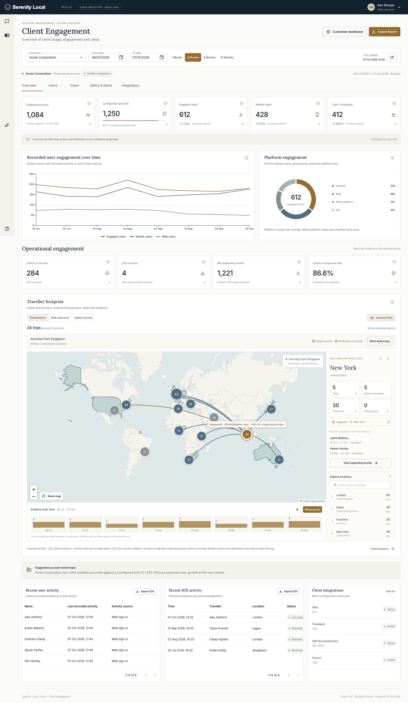

# AM Dashboard Prototype

Interactive client engagement and account-management dashboard concept, built with React, TypeScript, Vite and Material UI. **Serenity Local / HULA** is fictional branding. This project is intended solely as a UX/product prototype.

All customers, users, events, travel records, integrations and metrics are fictional. There is no backend, authentication or telemetry. No customer or provider APIs are called and no real customer information is included. The interactive map uses bundled world geography; all dashboard records and location summaries are computed locally, with no external map requests.

[Live demo](https://richardhanney.github.io/am-dashboard-poc/)



## Local setup

Requires Node 22.13+ or Node 24+ and npm; Node 24 is used for deployment.

```sh
npm ci
npm run dev
```

Open the local URL printed by Vite, normally `http://127.0.0.1:5173/`.

## Validation and production build

```sh
npm run lint
npm test
npm run build
npm run preview
```

The static output is in `dist/`. Preview is normally available at `http://127.0.0.1:4173/am-dashboard-poc/`. The production base defaults to `/am-dashboard-poc/` and can be configured with `PAGES_BASE_PATH`.

## Explore the prototype

The five tabs cover Overview, Users, Travel, Safety & Alerts and Integrations. Switch customers or dates, open metric receipt drawers, search/filter records and download CSV reports. Overview cards can be hidden or reordered, with layout preferences saved in browser localStorage. The sidebar celebration button fires local confetti; reduced-motion preferences are respected.

Overview's **Traveller footprint** is a full-width explorer built with Leaflet. Switch between destinations, illustrative risk exposure and recorded safety activity. With **Journey links** on, click any country or bubble to show only journeys originating there without changing the map zoom or position. The origin country is gold and its destination countries are teal; **Show all journeys** clears this focus. Location-list and next/previous controls also select countries without moving the map. Country bubbles remain available after selection, count destination trips before origin filtering, and never combine different countries. Nearby bubbles are separated with small leader lines so they remain clickable. Origin means the recorded itinerary start location, not traveller residence or nationality. With Journey links off, country/location controls explore destinations and grouped circles zoom into nearby locations. Recent journeys and clickable metric receipts explain the selected location. Destination rankings and region charts also remain available in Travel.

Fabricated journeys depart from varied countries while retaining each scenario's trip totals and destination mix. Empty selections explain departures versus arrivals in the side panel, leaving the map unobstructed. **Reset map** sits beside the zoom controls at the map's bottom-left; it restores the view and clears country selection while retaining the map's time/risk filters.

Use the eight-interval time scrubber or play/pause to explore recorded activity through the selected date range. **Whole period** restores the full range. Risk chips filter the explorer by exact trip risk, including a combined high/severe option. Time, risk and origin-country filters apply only to the map, spotlight and its supporting records; the headline dashboard cards retain the global customer/date selection. Safety metrics remain location records and are not attributed to a journey origin. Origin focus is suspended in Safety activity or with Journey links off. Playback pauses when a supporting-record drawer opens, and resets when the global customer/date selection changes.

Map positions are approximate public city centres, not current traveller locations. Journey curves are illustrative links between recorded itinerary endpoints, not actual flight paths. Trips use itinerary start dates, check-ins use request dates, and SOS uses record time. Circle numbers count trips or check-in + SOS records, depending on view. Risk colours reflect the highest illustrative trip risk at each location. Distinct travellers are deduplicated within a destination; destination traveller counts must not be summed into an account total.

No map key, paid service, geocoding or external map requests are used. The map uses bundled public-domain Natural Earth outlines. It supports zooming, panning, country/destination selection, journey links and timeline playback; it does not provide street-level road detail. See [basemap provenance](src/assets/README.md).

- **Acme Corporation:** healthy engagement, substantial travel and a configured user limit approaching capacity.
- **Globex International:** strong travel usage with lower recorded mobile adoption.
- **Northstar Energy:** lower engagement, more observed dormancy and greater illustrative higher-risk travel exposure.

The fixed fictional snapshot ends on 07 Oct 2026. Enabled accounts are a current snapshot, not a historical or commercial active-user measure. Engagement reflects recorded activity; mobile engagement is not proof of an installed app. Check-in response rate is completed / all requested, including pending and missed. Recorded alert sends do not establish delivery or reading. Commercial 365-day active-user criteria remain to be validated separately.

## GitHub Pages

The deployment workflow is **manual-only**. Pushing source does not deploy the site. In repository Settings → Pages, choose **GitHub Actions**. Run **Deploy mock dashboard to GitHub Pages** from the Actions tab on `main`.

The workflow uses GitHub's official actions, Node 24, `npm ci`, lint, tests and the static build, then uploads `dist/` and deploys it to Pages. It sets the repository base path automatically. Tabs use local React state, so no server routing is required. Fonts, icons and the original SVG wordmark are bundled locally.

See [validation notes](VALIDATION.md) and [design notes](DESIGN_REFERENCES.md). No licence has been added to this prototype repository.
